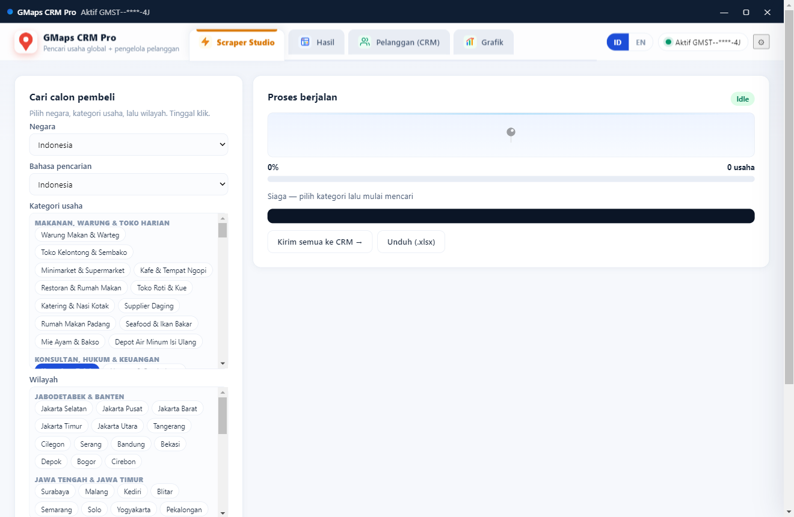
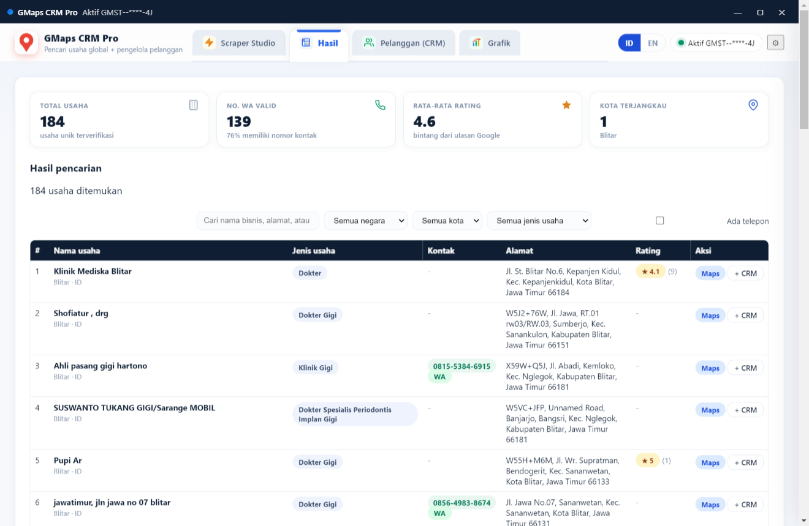

<div align="center">

  

  # GMaps CRM Pro — Scraper Studio Global + CRM
  ### Pencari usaha global 11 negara + pengelola pelanggan dalam satu aplikasi desktop

  [](https://github.com/99apps-id/gmaps-crm-pro/releases/latest)
  [](https://github.com/99apps-id/gmaps-crm-pro/releases/latest)
  [](https://github.com/99apps-id/gmaps-crm-pro)
  [](#-lisensi--pembayaran)

  <p align="center">
    Platform desktop intelijen direktori bisnis Google Maps global dengan kategori bilingual (Indonesia/English),
    CRM pelanggan bawaan (kanban, pengingat, pola pesan WA), grafik analitik, serta ekspor multi-format (Excel/CSV/JSON).
  </p>

  [📥 Unduh Installer](#-unduh-aplikasi-desktop) •
  [✨ Fitur Utama](#-fitur-utama) •
  [📸 Screenshot](#-antarmuka-aplikasi) •
  [💳 Lisensi & Pembayaran](#-lisensi--pembayaran) •
  [🚀 Cara Menjalankan](#-cara-menjalankan-development)

</div>

---

## 📸 Antarmuka Aplikasi

### 1. Scraper Studio — Cari Calon Pembeli Global
Pilih dari 120+ kategori bisnis bilingual, target negara & wilayah hingga kecamatan, lalu pantau progres live via Server-Sent Events (SSE).
<p align="center">
  
</p>

### 2. Hasil & KPI ala Enterprise
Jelajahi ribuan listing lengkap kontak WhatsApp, rating, koordinat, dan filter instan — dengan ringkasan KPI (total, WA valid, rating, kota).
<p align="center">
  
</p>

### 3. CRM Pelanggan Bawaan
Kirim hasil ke CRM dalam 1 klik: kanban Baru → Dihubungi → Tindak Lanjut → Negosiasi → Berhasil/Gagal, pengingat follow-up, pola pesan WA bilingual.
<p align="center">
  
</p>

### 4. Lisensi & Aktivasi Otomatis Pembayaran
Masa coba gratis 1 hari, lalu paket harian/mingguan. Setelah bayar via QRIS/VA, aplikasi aktif otomatis (1-klik deep-link, tanpa ketik ulang kode).
<p align="center">
  
</p>

---

## ✨ Fitur Utama

- 🎯 **120+ Kategori Bisnis Bilingual**: kuliner, kesehatan, otomotif, properti, sekolah & pesantren, agrobisnis, fashion, event, keuangan, energi — semua dengan keyword ID/EN yang dioptimalkan.
- 🗺️ **11 Negara, Sedalam Kecamatan**: Indonesia (Jabodetabek s.d. Papua), Malaysia, Jepang, Cina, Korea Selatan, AS, Kanada, Italia, Belanda, Jerman, Perancis — query otomatis dipecah per kecamatan/distrik.
- 📇 **CRM Terintegrasi**: kanban drag-and-drop, pengingat tindak lanjut (terlambat & 7 hari ke depan), riwayat aktivitas, skor prioritas leads 1–5, pola pesan WA bilingual siap kirim.
- 📊 **Grafik Analitik**: usaha per kota/jenis/negara, pelanggan per tahapan, kelengkapan kontak, sebaran rating.
- 📱 **One-Click WhatsApp**: klik langsung membuka `https://wa.me/62...` tanpa simpan kontak; badge telepon + filter khusus WA valid.
- 📊 **Multi-Format Export**: Excel (.xlsx multi-sheet + ringkasan), CSV (UTF-8 BOM), JSON — untuk Finder maupun CRM.
- 🔒 **Engine Terpusat Anti-Jailbreak**: scraper hanya berjalan di VPS (klien tidak membawa engine); serial wajib terdaftar; tripwire integritas mematikan engine bila aplikasi dimodifikasi.

---

## 📥 Unduh Aplikasi Desktop

| Platform | Format | Tautan Download |
| :--- | :--- | :--- |
| **Windows** | `.exe` (NSIS Installer) | [**Download GMaps CRM Pro Setup**](https://github.com/99apps-id/gmaps-crm-pro/releases/latest) |
| **macOS** | `.dmg` / `.zip` (Apple Silicon) | [**Download untuk Mac**](https://github.com/99apps-id/gmaps-crm-pro/releases/latest) |
| **Linux** | `.AppImage` / `.deb` | [**Download untuk Linux**](https://github.com/99apps-id/gmaps-crm-pro/releases/latest) |

> Catatan macOS: aplikasi belum di-sign Apple — klik-kanan → Open pada peluncuran pertama.

---

## 💳 Lisensi & Pembayaran

Aplikasi ini dilengkapi masa percobaan gratis (**Trial 1 Hari**) sejak pertama diinstal:

- **Paket Harian (1 Hari)**: Rp 15.000 — untuk kebutuhan penarikan prospek harian.
- **Paket Mingguan (7 Hari)**: Rp 50.000 — paling hemat untuk agensi dan tim sales.

> **Aktivasi Instan Otomatis**: setelah pembayaran QRIS/VA selesai, halaman klaim menampilkan tombol **Aktifkan Otomatis di Aplikasi** — satu klik, lisensi aktif tanpa mengetik ulang kode. Alternatif: tempel nomor referensi di modal Lisensi.

Lisensi, engine, dan pembayaran terpusat di server resmi.

---

## 🚀 Cara Menjalankan (Development)

Untuk kontributor atau developer yang ingin menjalankan proyek dari source code:

```bash
# Clone repository
git clone https://github.com/99apps-id/gmaps-crm-pro.git
cd gmaps-crm-pro

# Install dependensi
npm install

# Jalankan server lokal (http://localhost:3219)
npm start

# Jalankan aplikasi desktop Electron
npm run electron
```

### Mode engine

```bash
# Lokal (pakai engine built-in)
node server.js

# Klien (pakai engine VPS, seperti versi paket)
ENGINE_MODE=client node server.js
```

### Test

```bash
npm test
```

### Build Installer Mandiri

```bash
# Windows
npm run dist:win

# macOS
npm run dist:mac

# Linux
npm run dist:linux
```

Rilis multi-platform otomatis via GitHub Actions setiap tag `v*`.

---

## 🏗️ Arsitektur

- `server.js` — API finder + CRM + lisensi + payment (+ endpoint engine saat `ENGINE_MODE=engine` di VPS)
- `lib/` — license, payment, catalog (global bilingual), crm, scrape-runner, excel, xlsx (penulis Excel mandiri nol-dep)
- `lib/scraper.js` — **modul engine internal, tidak disertakan dalam paket aplikasi**
- `public/` — UI bilingual (ID/EN)
- `electron/` — main, preload, protocol deep-link, integrity-check
- `tools/` — gen-license (vendor), build-icon

---

<div align="center">
  <p>Dikembangkan oleh <b><a href="https://99apps.id">99apps.id</a></b> • Hak Cipta dilindungi Undang-Undang</p>
  <p>Butuh bantuan teknis atau kemitraan lisensi? Hubungi <b>support@99apps.id</b></p>
</div>
